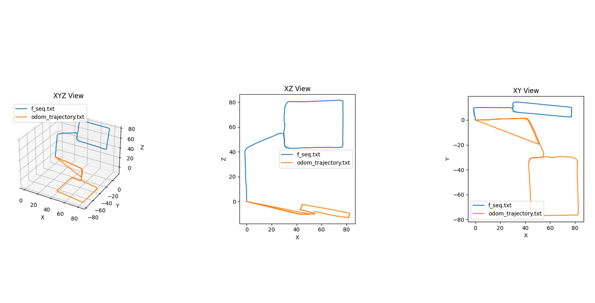

# My ORB WorkSpace orbslamex branch

## 01 build and install
```shell
git checkout orbslamex
# install ROS noetic
sudo apt-get install libeigen3-dev
cp -rf /usr/include/eigen3/Eigen /usr/include/Eigen -R 
sudo apt install ros-noetic-octmap*
catkin_make
```
运行步骤：
```
rosparam set use_sim_time true
rosrun orb_slam2_ros Stereo_gnss src/orb_slam2_lib/Vocabulary/ORBvoc.bin src/orb_slam2_ros/settings/zed2i640.yaml False seq
```


发布了一个机器人坐标系中的坐标 东北天  odom_trajectory.txt


- [x] dcdc

## EuRoc
- V1_01_easy
- V1_02_medium
- V1_03_difficult
- V2_01_easy
- V2_02_medium
- V2_03_difficult
- MH_01_easy
- MH_02_easy
- MH_03_medium
- MH_04_difficult
- MH_05_difficult
