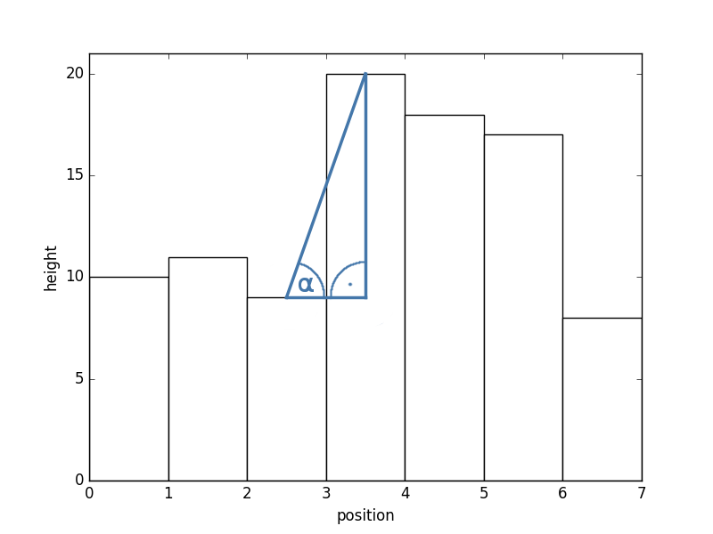

# ORB_SLAM2 ROS Extension

本文档描述了Jan Brehmer、Christopher-Eyk Hrabia和Sebastiano Barrera为ORB_SLAM2添加的特性。

## 1. ROS Interface

这个项目是从https://github.com/sebastiano-barrera/ORB_SLAM2派生出来的，使GUI成为可选的，而不是提供基本的ROS节点功能和主题广播，相机位置为“TransformationFrame”，地图点为“PointCloud”，跟踪状态为“String”。

This set of broadcasts was expanded by the tracking state as `ORBState` enum (see [section 5](#5-orbstate)), the map points as `Octomap` and two different projected 2D maps as `OccupancyGrid` (see [section 4](#4-2d-maps)).
这组广播通过跟踪状态扩展为“ORBState”枚举(参见[第5节](#5-ORBState))，地图点为“Octomap”，两个不同的投影2D地图为“occuancygrid”(参见[第4节](#4-2D-maps))。

各专题分别为:

* `map`
* `map_updates` (currently visible map points)
* `frame` (status image)
* `state`
* `state_description`
* `octomap`
* `projected_map`
* `gradient_map`


## 2. Catkin package structure

整个文件夹结构和CMake文件被调整为一个开箱即用的ros包。


## 3. Using an Odometry Transformation Frame

这句话讨论的是在使用ORB_SLAM2进行环境建图时，是否可以设置一个与ORB_SLAM2基础框架（相机）不同的参考框架，以便与OctoMap对齐。这在处理具有大量与其TF（例如里程计）方向对齐的平坦和矩形结构的环境时特别有用。简而言之，它在讨论如何调整框架以更好地匹配和处理特定类型的环境结构。

## 4. 2D Maps

### 4.1 Projected (cut) map

"穿过 z-区间的聚合切割（目前仅限于“最小高度”）。"

### 4.2 Gradient-based map

Octomap被遍历，并构建一个高度图，存储每个已知（x, y）坐标的最大z值。可以设置一个最大高度，从该高度开始，将忽略Octomap体素（例如，用于构建没有屋顶的室内地图）。由于ORB_SLAM2的地图点相当稀疏，如果可能的话，未知的z条目会通过其已知邻居的均值进行腐蚀。

该过程（`erodeNaN`）重复进行`occupancy_gradient_nb_erosions`次，这个次数可以作为ROS参数进行设置。

为了从生成的高度图构建占据栅格地图，对其坡度进行评估，这在下图中有所说明。



在坡度小于occupancy_gradient_low_slope（以弧度为单位）的地方，假定为空闲空间。如果坡度超过occupancy_gradient_high_slope，则假定为障碍物。介于两者之间的区域被称为灰色区域，并相应地进行插值。因此，将occupancy_gradient_low_slope设置为occupancy_gradient_high_slope会产生一个二进制的占据栅格地图。

为了在所有位置获取坡度，使用水平和垂直的Scharr滤波器计算了两个梯度图。Scharr滤波器是一种使用核的高通滤波器。
```
         [[ -3, 0,  -3],
k = 1/16  [-10, 0, -10],
          [ -3, 0,  -3]]
```
(or flipped by 90° respectively).

他们的绝对值被加到一个综合的梯度图中，然后使用以下方程从坡度值计算相应的梯度值：

`threshold = sin(slope) / cos(slope) * map_resolution`
在这里，slope 是坡度值，map_resolution 是地图的分辨率。

## 5. ORBState

ORB_SLAM2的跟踪状态通过state主题以ORBState伪枚举的形式进行广播。这是一个包含uint16 state和以下静态常量用作枚举器的消息：
`UNKNOWN`, `SYSTEM_NOT_READY`, `NO_IMAGES_YET`, `NOT_INITIALIZED`, `OK`, `LOST`
